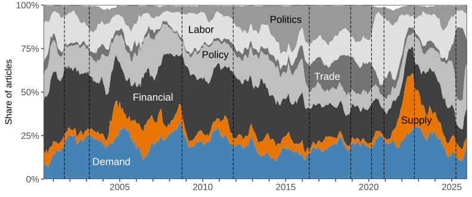

:::{.callout-important appearance="simple"}
## 2026--2027 Job Market Paper
[Download the latest draft](DeHaven-JMP-Source-Matters.pdf){target="_blank"}
:::

[Committee: [Şebnem Kalemli-Özcan](https://sebnemkalemliozcan.com){target="_blank"}, [Gauti B. Eggertsson](https://sites.google.com/site/gautieggertsson/home){target="_blank"}, [Amy Handlan](https://sites.google.com/view/amy-handlan){target="_blank"}]{.jmp-committee}

# Abstract

Using UK newspaper text, I separate economic uncertainty into demand and supply uncertainty using a large language model to label article topics. 
I find that demand uncertainty depreciates the pound and raises the currency risk premium on the pound relative to the dollar, while supply uncertainty appreciates the pound and lowers the currency risk premium.
I rationalize the results using a New Keynesian small open economy model with stochastic volatility, recursive preferences, and incomplete international risk sharing.
Under demand shocks a foreign-currency bond shares risk, but under supply shocks it raises risk, so rising uncertainty about each moves the domestic currency risk premium in opposite directions.
Incomplete international risk sharing lets the sign depend upon the source, while pricing frictions link the nominal and real responses, which move together in the data.
Level shocks cannot generate the observed changes in risk premia, so the data point to time-varying risk.
An aggregate measure of uncertainty masks these opposite responses.

::: {#fig-2 style="font-size: 60%;"}
{width=7in}

Share of UK Uncertainty Attributed to Each Economic Topic
:::
